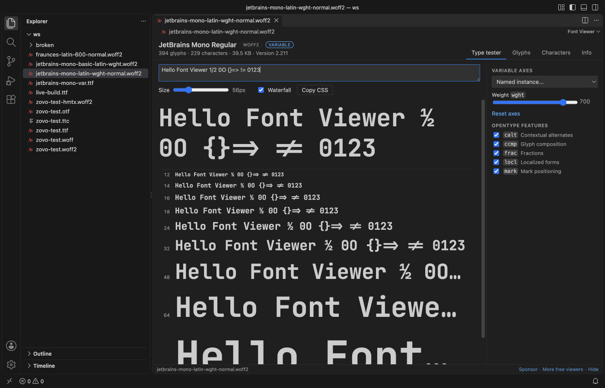
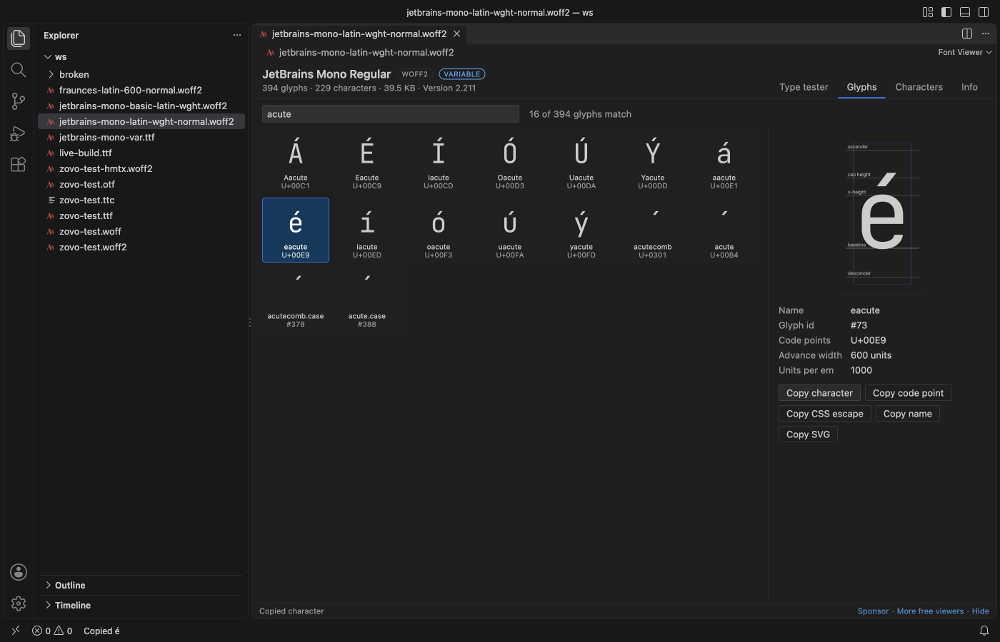
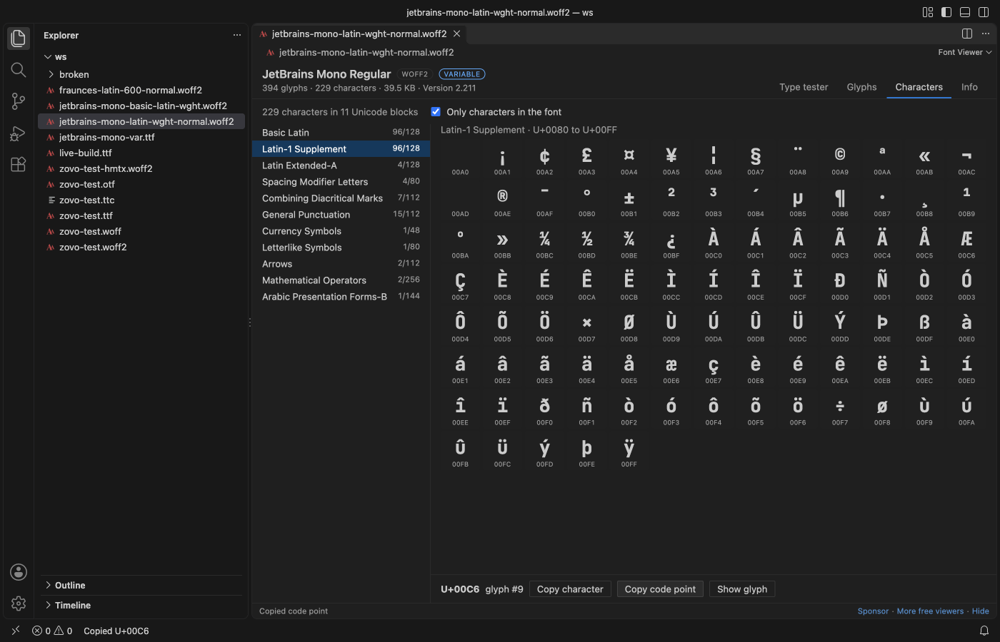
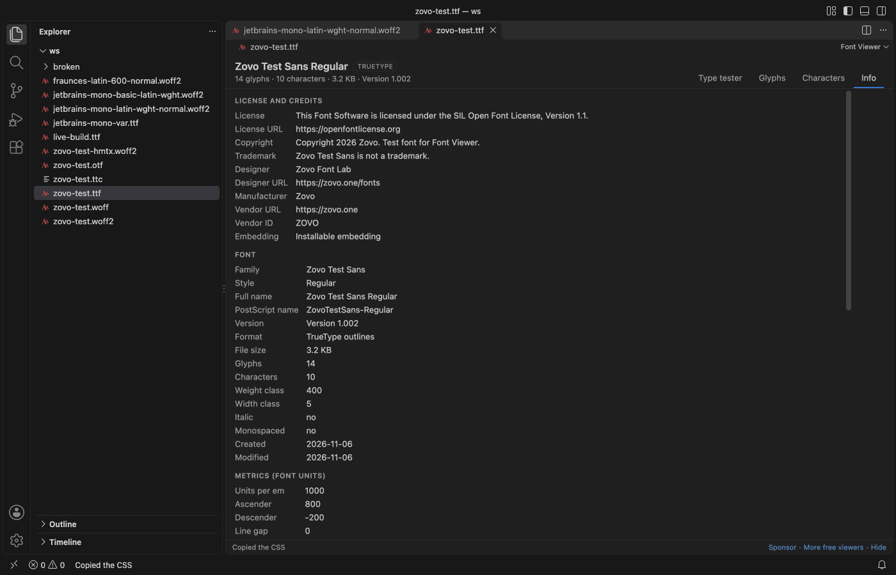
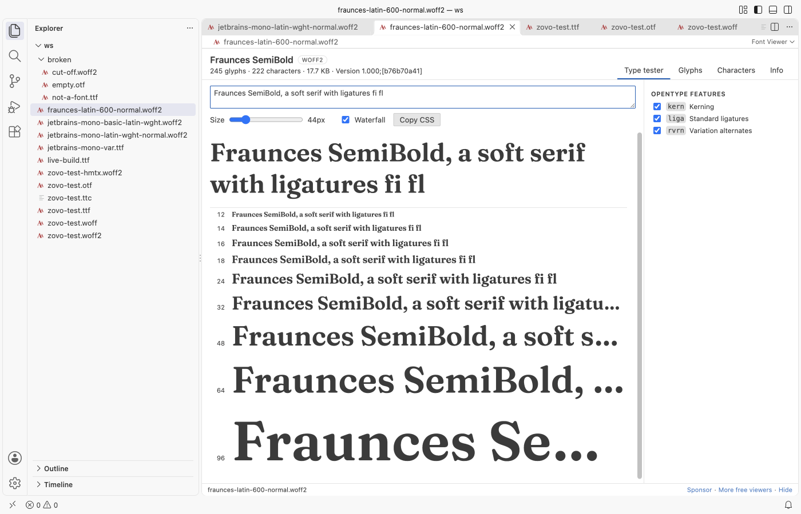

# Font Viewer, TTF Viewer, OTF & WOFF Viewer

Open any TTF, OTF, WOFF, WOFF2 or TTC font in VS Code to test text with its variable axes and OpenType features, see every glyph, and read its license before you ship it.

*Screenshots come from a real VS Code 1.142 window running the packaged extension. The fonts are JetBrains Mono and Fraunces (both SIL Open Font License 1.1) and Zovo Test Sans, a small test font made by `scripts/make-fixtures.py`.*

- Test real text. Type a sample, drag the size slider, and check a waterfall from 12 to 96 px. Move the weight, width or any custom axis, and turn features like `liga`, `kern`, `ss01` or `zero` on and off.
- See every glyph, also ligatures and alternates that no key types. Search by name, character, `U+20AC` or glyph id, and copy the character, the code point or the outline as SVG.
- Check the license. The Info tab shows the license, designer, copyright and embedding rights, and gives you a ready `@font-face` rule.

## Quick start

1. Install the extension.
2. Click a `.ttf`, `.otf`, `.woff`, `.woff2` or `.ttc` file in the Explorer.

Font Viewer is the default editor for these files. It's read-only, so it never changes the font.

## What you can do

| Tab | What it shows |
|---|---|
| Type tester | Your sample text in the font, a size slider from 8 to 200 px and a waterfall. A slider for each variable axis, a list of named instances, and a check box for each OpenType feature. Copy CSS gives the `@font-face` rule plus the matching `font-variation-settings` and `font-feature-settings`. |
| Glyphs | Every glyph drawn from its outline, with its name and code point. Glyphs load in pages as you scroll, so a CJK font with 20,000 glyphs opens fast. Click one to see it large with the baseline, x-height, cap height and advance width. |
| Characters | The characters of the font grouped by Unicode block, with coverage such as "Basic Latin 95/128". Turn off "Only characters in the font" to see the gaps. |
| Info | License and credits, the full name table, metrics, axes and instances, GSUB and GPOS feature tags, all tables with sizes, and the `@font-face` rule. |

## Supported files

| Format | Extensions | Notes |
|---|---|---|
| TrueType | `.ttf` | Also variable fonts. |
| OpenType | `.otf` | CFF outlines. CFF2 variable fonts show their text and metadata, but the glyph grid draws them with the font instead of from outlines. |
| WOFF | `.woff` | Unpacked with Node's zlib. |
| WOFF2 | `.woff2` | Unpacked by our own decoder, which rebuilds the glyf, loca and hmtx tables. |
| Collections | `.ttc`, `.otc` | Pick the font from a list in the header. |

When you save a new build of a font, the open view reloads.

You can also right-click a font in the Explorer and choose Copy CSS @font-face without opening it.

## Settings

| Setting | Default | What it does |
|---|---|---|
| `fontViewer.sampleText` | The quick brown fox jumps over the lazy dog. 0123456789 | Text in the type tester and the waterfall. You can edit it in the view too. |
| `fontViewer.previewSize` | 48 | Starting size in pixels of the large sample. |
| `fontViewer.maxFileMB` | 64 | Larger files show a message instead of opening. |
| `fontViewer.askForRating` | true | One rating request after a few days of use. |
| `fontViewer.showSupportLinks` | true | The small Sponsor and More free viewers links in the status line. |

## Privacy

Font Viewer works offline. It makes no network calls and sends no telemetry. The font is read from disk and loaded into the view from memory, and the view has a strict Content Security Policy with no remote scripts. Font names and other text from the file are shown as plain text.

## Known limits

- Glyph outlines show the default instance of a variable font. The type tester, waterfall and character map follow the axis sliders.
- Color fonts (COLR, SVG, sbix, CBDT) are drawn in color in the type tester and the character map, but the glyph grid shows their plain outlines.
- WOFF2 collections, SVG fonts, `.dfont` and Type 1 fonts aren't supported.
- Shaping in the type tester comes from VS Code's own engine (Chromium), so it matches what a browser shows.

## Support Zovo

Zovo extensions are free, with no ads and no tracking. They are made by [theluckystrike](https://github.com/theluckystrike) on GitHub. If this one saves you time, you can support the work:

- [Sponsor on GitHub](https://github.com/sponsors/theluckystrike)
- [Follow theluckystrike on GitHub](https://github.com/theluckystrike)

## More tools by Zovo

- [MP4 & MOV Viewer, Video Player with Sound](https://marketplace.visualstudio.com/items?itemName=zovo.video-preview-with-sound) plays MP4, MOV, MKV and WebM files with their sound.
- [Audio Player & WAV Player (MP3, FLAC, LUFS)](https://marketplace.visualstudio.com/items?itemName=zovo.audio-preview-vscode) plays audio files with a waveform, a spectrogram and LUFS loudness.
- [STL Viewer, OBJ Viewer, GLB & glTF Viewer](https://marketplace.visualstudio.com/items?itemName=zovo.3d-model-viewer) views GLB, glTF, STL, OBJ, PLY and 3MF models.

See [all Zovo extensions on the Marketplace](https://marketplace.visualstudio.com/publishers/zovo).

## License

MIT. Font Viewer bundles opentype.js (MIT). See THIRD-PARTY-NOTICES.md.

## More from zovo

- [All free zovo VS Code extensions](https://marketplace.visualstudio.com/publishers/zovo) — file viewers, database clients, formatters. Offline, no telemetry, no sign-up.
- [Full MCP server catalogue](https://theluckystrike.github.io/mcp/) — local-first MCP servers for back-office work: invoices, VAT, PDFs, spreadsheets, payroll.
- [Hosted no-install MCP endpoints](https://mcp.zovo.one) — paste a URL in Claude / Cursor, nothing to install.
